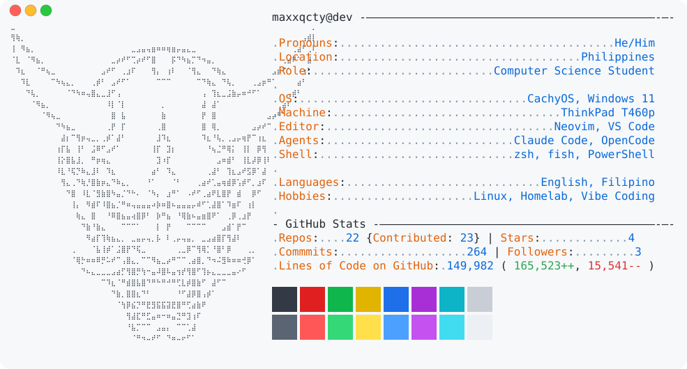
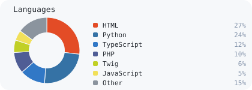

  <picture>
    <source media="(prefers-color-scheme: dark)" srcset="https://raw.githubusercontent.com/maxxqcty/maxxqcty/main/header-banner.svg">
    
  </picture>

<table>
  <tr>
    <td valign="top">
      <a href="https://github.com/maxxqcty/maxxqcty">
        <picture>
          <source media="(prefers-color-scheme: dark)" srcset="https://raw.githubusercontent.com/maxxqcty/maxxqcty/main/dark_mode.svg">
          
        </picture>
      </a>
    </td>
    <td valign="top">
      <picture>
        <source media="(prefers-color-scheme: dark)" srcset="https://raw.githubusercontent.com/maxxqcty/maxxqcty/main/languages_dark.svg">
        
      </picture>
       
      <picture>
        <source media="(prefers-color-scheme: dark)" srcset="https://streak-stats.demolab.com?user=maxxqcty&theme=dark&background=161b22&hide_border=true&disable_animations=true">
        
      </picture>
    </td>
  </tr>
</table>

<!-- haiku:start -->

*The good year grows old* *and swallows build against eaves* *while summer still holds*

2026-11-10

<!-- haiku:end -->

FRONTEND 
      

BACKEND 
     

DATABASE &amp; CLOUD 
    

MOBILE 
  

DEVOPS &amp; TOOLS 
  

DESIGN &amp; CREATIVE 
    
